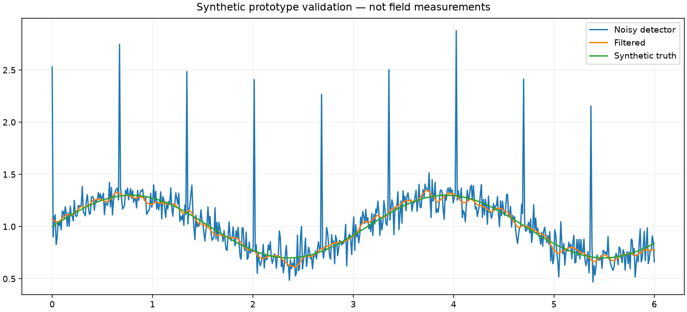

# 检波信号滤波

## 当前实现

C11 实现中值去脉冲，再移动平均平滑；不实现射频硬件检波。Python 版本保留为参考和结果可视化工具。

这是可运行的数值基线原型，不等同于网站介绍中的完整系统。

## C 版本快速运行

需要 C11 编译器与 make，无第三方 C 库依赖。

```sh
make
make test-c
./build/detector_demo > detector-demo.csv
```

演示向标准输出写入 600 行合成信号 CSV（另含表头），向标准错误输出滤波前后 RMSE。C 演示使用确定性正弦噪声，与 Python 演示的随机噪声不同；同输入一致性由对照测试单独验证。该演示不是硬件实测。

### 集成到 C 或 C++ 程序

将 `c/detector_filter.c` 和 `c/detector_filter.h` 加入工程，链接数学库（Unix 通常为 `-lm`）：

```c
#include "detector_filter.h"

double samples[] = {1, 2, 100, 4, 5};
double output[5];
detector_status status = detector_filter(samples, 5, 3, output);
if (status != DETECTOR_OK) {
    /* Handle invalid arguments, nonfinite input or allocation failure. */
}
```

输入输出都是长度为 `count` 的 `double` 数组，输出空间由调用者分配；允许输入输出使用同一数组。错误时不修改输出。返回码：0 成功、1 参数错误、2 输入含 NaN/Inf、3 内存分配失败。数组容量必须由调用者保证，禁止使用会破坏有限值检查的 `-ffast-math`。

C 版本与 Python 一样，中值阶段采用 reflect 边界，移动平均阶段采用 edge 边界；先缩放到有界范围计算均值再恢复幅值。当前为批处理实现，额外内存 O(n + w)，时间 O(n·w·log w)，尚未针对嵌入式、无堆内存或实时流式处理优化。

## 输入契约

有限数值的一维等间隔采样检波信号，`window` 必须是信号长度以内的正奇数整数（不接受布尔值或浮点数）。C 接口位于 `c/detector_filter.h`；Python 参考函数位于 `src/prototype.py` 的 `process`。默认命令运行固定种子合成样例，并在代码中断言预期效果；真实数据需由调用者按照函数形状约束传入。

## Python 参考与对照测试

Python 3.11+，对照测试还需要 C 编译器。

```sh
python -m venv .venv
source .venv/bin/activate
pip install -r requirements.txt
python src/prototype.py --output artifacts
python -m unittest discover -s tests -v
```

移动平均在归一化尺度上计算，避免接近 float64 上限的有限输入因累加舍入而溢出；回归测试覆盖正负极值、极小幅值和不同信号单位。此处理不增加射频硬件检波能力。

## 输出与验证

- `artifacts/result.png`：当前代码生成的结果可视化。
- `artifacts/metrics.json`：样例指标。
- `artifacts/results.npz`：结果数组，按图例顺序编号。



```json
{
  "raw_rmse": 0.20540606716562915,
  "filtered_rmse": 0.02993175503758234
}
```

固定种子回归检查与异常数据检查已运行。图中数据均为合成，不是硬件实测，也不是应用界面截图。

## 需求、架构与边界

[PRD](docs/PRD.md) · [当前原型范围](docs/IMPLEMENTATION.md) · [验证记录](docs/VALIDATION.md)

窗口长度决定平滑与响应延迟，真实噪声需重新选择参数。

## 后续里程碑

1. 使用真实输入建立基准数据及明确误差界限。
2. 补充数据导入和交互界面，按需求接入 SDK、设备或模型。
3. 记录独立测试集、资源消耗和失败案例，再评估部署条件。
