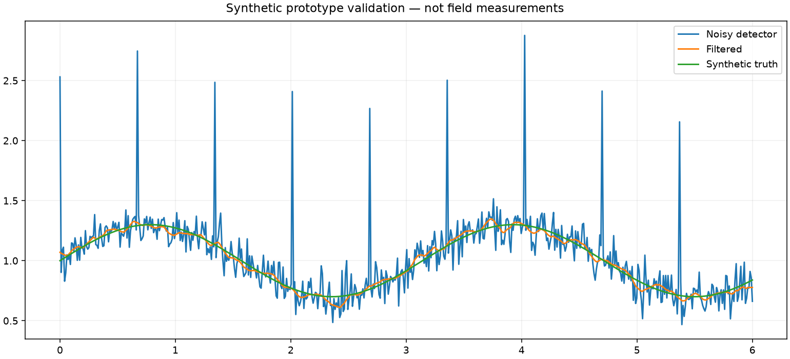

# 检波信号滤波

## 当前实现

中值去脉冲，再移动平均平滑；不实现射频硬件检波。

这是可运行的数值基线原型，不等同于网站介绍中的完整系统。

## 输入契约

一维等间隔采样检波信号。核心函数位于 `src/prototype.py` 的 `process`，可直接导入调用。默认命令运行固定种子合成样例，并在代码中断言预期效果；真实数据需由调用者按照函数形状约束传入。

## 快速运行

Python 3.11+。

```sh
python -m venv .venv
source .venv/bin/activate
pip install -r requirements.txt
python src/prototype.py --output artifacts
python -m unittest discover -s tests -v
```

## 输出与验证

- `artifacts/result.png`：当前代码生成的结果可视化。
- `artifacts/metrics.json`：样例指标。
- `artifacts/results.npz`：结果数组，按图例顺序编号。



```json
{
  "raw_rmse": 0.20540606716562915,
  "filtered_rmse": 0.02993175503758234
}
```

固定种子回归检查与异常数据检查已运行。图中数据均为合成，不是硬件实测，也不是应用界面截图。

## 需求、架构与边界

[PRD](docs/PRD.md) · [当前原型范围](docs/IMPLEMENTATION.md) · [验证记录](docs/VALIDATION.md)

窗口长度决定平滑与响应延迟，真实噪声需重新选择参数。

## 后续里程碑

1. 使用真实输入建立基准数据及明确误差界限。
2. 补充数据导入和交互界面，按需求接入 SDK、设备或模型。
3. 记录独立测试集、资源消耗和失败案例，再评估部署条件。
